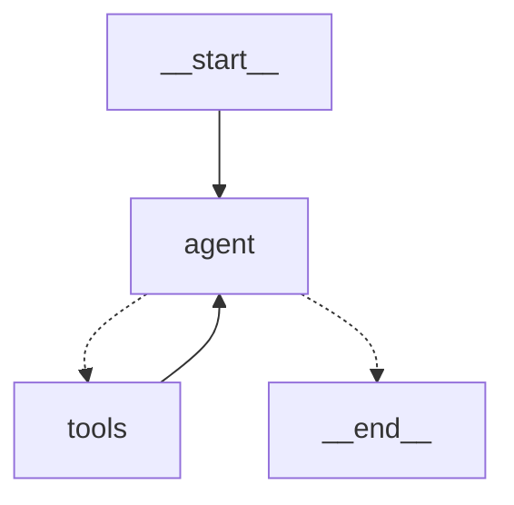

# simple-langgraph-agent

A minimal [LangGraph](https://langchain-ai.github.io/langgraph/) agent: a math assistant that uses calculator tools in an agent → tools → agent loop, with in-memory conversation history.



## Quick start

Requires Python 3.10+ and an OpenAI API key.

```bash
git clone https://github.com/zac11/simple-langgraph-agent.git
cd simple-langgraph-agent
python3 -m venv .venv
source .venv/bin/activate        # Windows: .venv\Scripts\Activate.ps1
pip install -r requirements.txt
cp .env.example .env             # then put your key in .env
python agent.py
```

```text
You: What is 12.5 multiplied by 4, minus 7?
  [agent] calling multiply({'a': 12.5, 'b': 4})
  [tool] multiply -> 50.0
  [agent] calling subtract({'a': 50.0, 'b': 7})
  [tool] subtract -> 43.0
Agent: 12.5 multiplied by 4, minus 7 is 43.
```

To use another provider, install its LangChain package and set `MODEL` in `.env`, e.g. `MODEL=ollama:llama3.1` with `pip install langchain-ollama` for a fully local model.

## Tests

The tests use a scripted fake model, so no API key is needed:

```bash
pip install pytest
python -m pytest
```

## Files

| File | Purpose |
| --- | --- |
| `agent.py` | Tools, graph definition, and terminal chat loop |
| `tests/test_agent.py` | Graph test with a fake model |
| `requirements.txt` | Dependencies |
| `.env.example` | Template for your API key and model choice |
